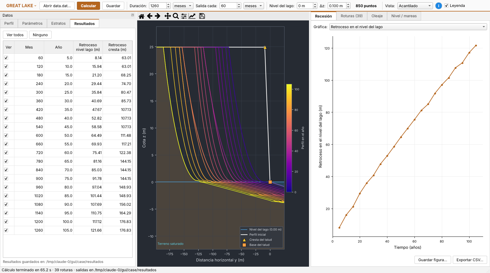

# cliff-recession

Modelo de erosión y retroceso de acantilados de arcillas (tills) en lagos sin
marea (lago Erie), de R. Castedo (UPM). La tesis doctoral relacionada está en
`tesis/`.

## Contenido

| Fichero | Descripción |
|---|---|
| `Great_lake_v.1.f90` | Código original en Fortran (Intel Visual Fortran). |
| `great_lake.py` | Traducción a Python del código Fortran (motor de cálculo). |
| `great_lake_gui.py` | Herramienta gráfica de escritorio sobre `great_lake.py`. |
| `ejemplos/caso_base/data.dat` | Caso base: 1260 meses, sin playa, terreno saturado, un estrato. |
| `ejemplos/caso_simple/data.dat` | Caso simple de comprobación: 10 años, con playa, nivel freático, dos estratos y un punto de estudio. |
| `tools/restore_fortran.py` | Adapta el `.f90` para compilarlo con gfortran (cambios mínimos de sintaxis). |
| `tools/compare_outputs.py` | Compara valor a valor las salidas de ambas versiones. |
| `tools/verify.sh` | Compila el Fortran, ejecuta las dos versiones y compara los resultados. |

## Uso de la versión en Python

Requiere Python 3 y NumPy.

```bash
python great_lake.py ejemplos/caso_simple
```

Lee `data.dat` del directorio indicado y escribe allí `timerecesion.out`,
`Matriz_dibujo.out`, `Matriz_roturas.out`, `Matriz_recesion.out` y
`Matriz_seepage.out`, con el mismo formato que el programa Fortran.

## Herramienta gráfica

```bash
pip install -r requirements.txt
python great_lake_gui.py ejemplos/caso_simple/data.dat
```



- **Panel «Datos»** (izquierda):
  - edición del perfil inicial (cota, distancia y tipo de punto);
  - edición de los parámetros y de los estratos;
  - lista de los perfiles de salida, con casillas «Ver».
- **Vista central**: el perfil con el nivel del lago, el nivel freático y los
  puntos singulares. Se actualiza al editar los datos. Tras calcular, muestra
  los perfiles en cada instante de salida (escala de color por año). Tiene dos
  vistas, «Acantilado» y «Perfil completo», y zoom con la barra de matplotlib.
- **Pestañas de la derecha**:
  - *Recesión*: gráficas de retroceso y de volumen, que se pueden exportar a
    PNG o CSV.
  - *Roturas*: el perfil antes y después de cada rotura.
  - *Oleaje*: tabla editable del oleaje por estación. Por defecto tiene los
    valores del código original; si se modifica, los resultados dejan de
    coincidir con el Fortran.
  - *Nivel / mareas*: carga y representación de una serie de niveles. Solo se
    visualiza; el modelo usa un nivel del lago constante.
- **Calcular**: se ejecuta en segundo plano, con barra de progreso y botón
  para detener. Los ficheros de salida se guardan en la carpeta `resultados/`,
  junto al `data.dat`. Los resultados son idénticos a los de `great_lake.py`
  por línea de órdenes.

## Verificación

```bash
tools/verify.sh ejemplos/caso_base
tools/verify.sh ejemplos/caso_simple
```

En los dos casos las cinco salidas son **idénticas** a las del Fortran
compilado con gfortran (diferencia máxima 0). Entre los dos casos se ejercitan
todos los bloques del modelo:

- erosión por esfuerzo cortante, por impacto del oleaje y por run-up;
- formación de playa y berma;
- roturas circulares, incluidas las descartadas por "crear material", y
  roturas por vuelco;
- salto temporal por protección de derrubios;
- nivel freático de los tipos 1 y 2.

La traducción es literal a propósito para reproducir exactamente el
comportamiento numérico del original:

- Los índices empiezan en 1 y se respetan los bucles DO y los GO TO.
- Se respeta la división entera.
- Las constantes escritas sin `d0` en el original son de precisión simple,
  incluido `pi = 3.141592653589793`, que vale 3.1415927410…
- Las funciones elementales son las de la libm de C.

La versión en Python es más lenta que la de Fortran: unos 60 s frente a ~1 s
en el caso base.

## Notas sobre el código original

- `lakelevel` es INTEGER, pero `data.dat` trae `0.0`. gfortran no acepta esa
  lectura, así que la referencia lee un real y lo trunca, igual que la versión
  Python. Intel Fortran sí la acepta.
- Varias constantes no llevan `d0` (`pi`, `1.56`, `9.81` en `freshwater`, las
  frecuencias del oleaje…), por lo que se evalúan en precisión simple. El
  efecto es pequeño, pero conviene saberlo.
- La variación interanual del nivel del lago (`changelakelevel`) está
  desactivada y las líneas `TL = controllevel…` están comentadas, así que el
  nivel del lago no cambia.
- Con gfortran, `open(6, file='Matriz_roturas.out')` hace que los mensajes de
  pantalla se escriban también en ese fichero, porque la unidad 6 es la salida
  estándar. `tools/verify.sh` los filtra. Con Intel Fortran no ocurre.
- `marea.dat` no se usa: el `open` correspondiente está comentado.
