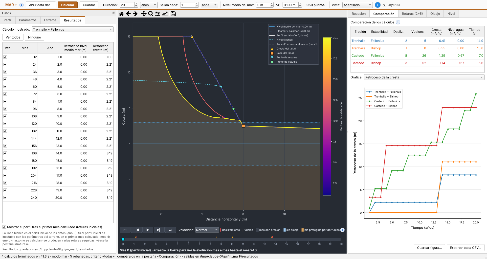
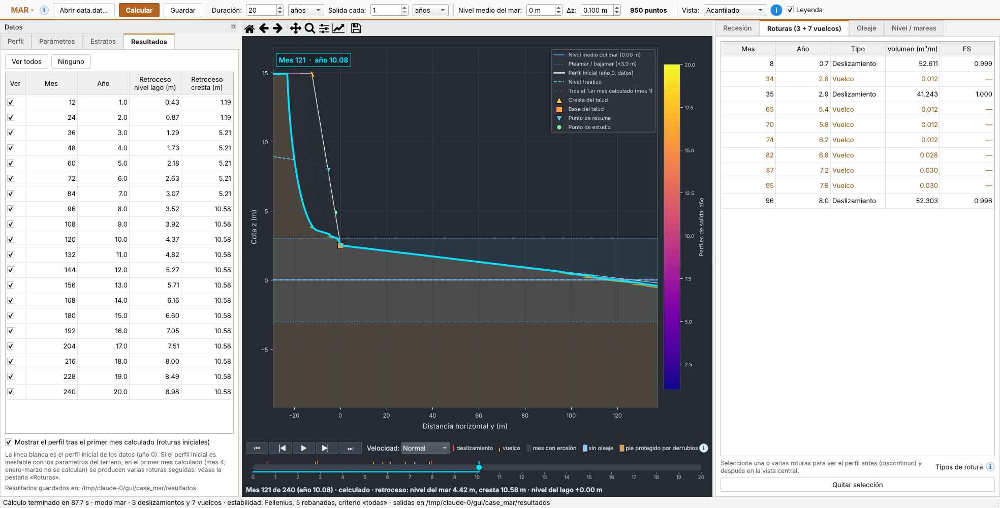

# cliff-recession

Modelo de erosión y retroceso de acantilados de arcillas (tills) en lagos sin
marea (lago Erie), de R. Castedo (UPM). La tesis doctoral relacionada está en
`tesis/`.

## Contenido

| Fichero | Descripción |
|---|---|
| `Great_lake_v.1.f90` | Código original en Fortran (Intel Visual Fortran). |
| `Cliff_erosion_4.1.f90` | Código original de Castedo y Paredes para costas marinas (2009–2011, Intel Fortran): modelo estadístico y modelo proceso-respuesta de los cap. 8–9 de la tesis. Solo como referencia; no está traducido. |
| `great_lake.py` | Traducción **fiel** a Python del código Fortran: da exactamente los mismos resultados. No tiene opciones nuevas. |
| `great_lake_motor.py` | Motor de la herramienta: `great_lake.py` más opciones que no están en el original (nivel del lago variable, Bishop/Spencer, nº de rebanadas, criterio de rotura). Con las opciones por defecto da lo mismo que `great_lake.py`. |
| `great_lake_gui.py` | Herramienta gráfica de escritorio sobre `great_lake_motor.py`. |
| `ejemplos/caso_base/data.dat` | Caso base: 1260 meses, sin playa, terreno saturado, un estrato. |
| `ejemplos/caso_simple/data.dat` | Caso simple y realista: acantilado de 10 m a 45° (estable al inicio), 20 años, playa pequeña, nivel freático, dos estratos y un punto de estudio. Parámetros dentro de los rangos de la tesis (cap. 10). |
| `ejemplos/caso_mar/` | Caso marino tipo Holderness (modo mar de la herramienta): till de 15 m a 45°, marea ±3 m, subida del nivel del mar 6 mm/año. Incluye `data.herramienta.json`, que abre la herramienta en modo mar. |
| `ejemplos/caso_extremo/data.dat` | Caso de comprobación con parámetros desfavorables (fuera de los rangos de la tesis). Retrocede muy rápido, pero ejercita todas las partes del código. |
| `tools/restore_fortran.py` | Adapta el `.f90` para compilarlo con gfortran (cambios mínimos de sintaxis). |
| `tools/compare_outputs.py` | Compara valor a valor las salidas de ambas versiones. |
| `tools/verify.sh` | Compila el Fortran y comprueba que Fortran = `great_lake.py` = `great_lake_motor.py` (opciones por defecto). |
| `tools/test_estabilidad.py` | Pruebas de los métodos de estabilidad (Fellenius, Bishop, Spencer). |
| `tools/test_mar.py` | Pruebas del modo mar y de los vuelcos. |
| `tools/test_castedo.py` | Pruebas de la erosión marina de Castedo frente a lo publicado en la tesis. |

## Uso de la versión en Python

Requiere Python 3 y NumPy.

```bash
python great_lake.py ejemplos/caso_simple
```

Lee `data.dat` del directorio indicado y escribe allí `timerecesion.out`,
`Matriz_dibujo.out`, `Matriz_roturas.out`, `Matriz_recesion.out` y
`Matriz_seepage.out`, con el mismo formato que el programa Fortran.

## Motor de la herramienta: opciones adicionales

`great_lake_motor.py` admite opciones que se apartan del modelo original.
Todas están desactivadas por defecto, y entonces da exactamente lo mismo que
`great_lake.py`.

```bash
python great_lake_motor.py ejemplos/caso_simple --metodo bishop --rebanadas 20 --criterio profunda --nivel-estacional --nivel-interanual
```

### Erosión marina de Castedo (`--erosion castedo`)

Es la erosión del modelo marino de la tesis (capítulos 5, 8 y 9). En cada ciclo
de marea (ec. 8.1):

Δy = Hb^(13/4) · Tb^(3/2) / (K · σc) · tan β · ∫ pw((w(t) − z)/Db) dt

- Hb: altura de rotura, de Komar y Gaughan. Db = Hb/0,78.
- σc: resistencia a compresión, de la columna UCS de los estratos.
- tan β: pendiente local, limitada a 60°.
- w(t): marea sinusoidal.
- pw: función de forma, el polinomio racional de Chebyshev de la tabla 5.iv,
  ajustado a los ensayos de Skafel y Bishop.
- La integral se calcula con la regla de Simpson y 100 pasos por marea
  (Δt = 448,56 s), como en el cap. 8.

Con los valores de la tesis para Holderness (ola media 0,98 m y 7,66 s, marea
de 3 m, K = 102, till de 182 kPa) da 1,3–1,5 m/año, frente a 1,55 m/año medidos.
Las unidades no están del todo fijadas en la tesis; aquí σc va en MPa, pw en
mm/h y el tiempo en horas. Por defecto usa además las fracciones de derrubios de
la tesis: 70 % de un deslizamiento y 0 % de un vuelco. Las pruebas están en
`tools/test_castedo.py`.

```bash
python great_lake_motor.py ejemplos/caso_mar --mar --erosion castedo --K 102
```

### Modo mar (`--mar`)

El modelo original es para lagos sin marea. El modo mar lo adapta a costas
marinas con tres cambios:

- **Marea sinusoidal** de amplitud A: el rango [−A, +A] se divide en niveles.
  En cada nivel actúa el oleaje del mes, con un número de olas proporcional al
  tiempo que el agua pasa en él: (asen(z₂/A) − asen(z₁/A))/π. Así la erosión
  se reparte en altura, en lugar de concentrarse en una sola cota.
- **Sin hielo**: se calculan los 12 meses, cada uno con el oleaje de su
  estación.
- **Subida del nivel medio del mar** (mm/año).

Valores por defecto basados en Holderness (tesis, cap. 9): A = 3 m y subida
de 6 mm/año. El oleaje por defecto es una distribución ilustrativa cuya altura
media (≈1 m) coincide con la de la boya de Hornsea; conviene sustituirlo por
datos reales.

No existe un Fortran marino con el que comparar. Se comprueba con
`tools/test_mar.py`: con A = 0, sin subida y el oleaje del lago, el modo mar
reproduce exactamente el modo lago. Esa prueba incluye los saltos por
derrubios.

```bash
python great_lake_motor.py ejemplos/caso_mar --mar --amplitud-marea 3 --subida-mar 6
```

En `caso_mar`, la cara del acantilado retrocede del orden de 1 m/año (unos 10–13 m
en 10 años entre 4 y 14 m de cota). Holderness retrocede de media 1,55 m/año
según la tesis. Los parámetros no están calibrados para ese sitio.

### Nivel del lago variable

El original tiene comentada una variación del nivel del lago, y aquí se puede
activar:

- `--nivel-estacional`: aplica los niveles de la tabla 10.iii de la tesis,
  +0,40 m en primavera y +0,30 m en verano respecto a invierno y otoño.
- `--nivel-interanual`: añade un ciclo de 15 años de ±5·Δz (±0,5 m con
  Δz = 0,1 m), con cambios cada 9 meses desde el mes 69.

El ciclo interanual comentado en el original perdía los cambios que caían en
invierno o durante un salto por derrubios, y el nivel derivaba hacia arriba
(+1,4 m en 100 años). Aquí se aplican todos los cambios pendientes y el nivel
oscila correctamente.

### Estabilidad de las roturas circulares

- `--metodo`:
  - `fellenius`: método ordinario de rebanadas. Es el del original y el de la
    tesis; el más conservador.
  - `bishop`: Bishop simplificado (1955). Cumple el equilibrio de momentos y
    de fuerzas verticales; es el estándar en la práctica.
  - `spencer`: Spencer (1967). Riguroso: cumple todas las ecuaciones de
    equilibrio. Se resuelve partiendo de Bishop. Si no converge, o da una
    solución a más de un 15 % de Bishop, se usa Bishop y se cuenta como «no
    convergido».
- `--rebanadas`: número de rebanadas (original: 5).
- `--criterio`:
  - `todas` (original): rompe cada círculo con FS < 1, de dentro afuera.
  - `profunda`: rompe el círculo inestable más profundo, que es lo que
    describe la tesis.
  - `minimo`: rompe el de menor FS.

Los métodos se comprueban con `tools/test_estabilidad.py`:

- con suelo puramente cohesivo los tres dan el mismo FS;
- Bishop coincide con Spencer con θ = 0;
- la solución de Spencer cumple el equilibrio de fuerzas y el de momentos;
- Bishop ≥ Fellenius, y Spencer queda a menos de un 3 % de Bishop.

Efecto en los ejemplos (5 rebanadas, criterio `todas`):

| Caso | Método | Roturas | Retroceso de la cresta |
|---|---|---|---|
| `caso_simple` (20 años) | Fellenius / Bishop / Spencer | 2 / 1 / 1 | 0,57 / 0,38 / 0,38 m/año |
| `caso_base` (105 años) | Fellenius / Bishop / Spencer | 39 / 35 / 35 | 1,68 / 1,72 / 1,69 m/año |

A largo plazo, el retroceso lo controla sobre todo la erosión del pie. El
método cambia cuándo rompe el acantilado y el tamaño de cada rotura. Los
círculos críticos tienen FS de 0,97–0,99, así que unos pocos puntos de
diferencia en el FS adelantan o retrasan las roturas. Los parámetros de la
tesis se calibraron con Fellenius.

## Herramienta gráfica

```bash
pip install -r requirements.txt
python great_lake_gui.py ejemplos/caso_simple/data.dat
```


**Lago / mar**: el botón de arriba a la izquierda (LAGO ▾ / MAR ▾) cambia de
modo. En modo mar, la pestaña *Nivel / mareas* tiene la amplitud de la marea,
la subida del nivel del mar y el número de niveles de marea, y la vista
muestra la franja entre bajamar y pleamar. Al guardar, las opciones de la
herramienta (modo, marea, estabilidad, oleaje…) se escriben en
`data.herramienta.json`, junto al `data.dat`, y se recuperan al abrirlo.

**Métodos de cálculo y comparación**: en *Parámetros* se marcan uno o varios
métodos de erosión (Trenhaile, Castedo) y de estabilidad (Fellenius, Bishop,
Spencer), cada uno con su botón (i). Al calcular se ejecutan todas las
combinaciones, cada una en una subcarpeta de `resultados/`.

- La pestaña *Comparación* resume los cálculos en una tabla (roturas, retroceso
  de la cresta y del nivel del agua, tiempo) y los superpone en una gráfica
  (retroceso, volumen de roturas o perfil final).
- Al elegir un cálculo, en la tabla o en «Cálculo mostrado», las demás vistas
  pasan a mostrarlo.
- Por defecto: en lago, Trenhaile + Fellenius (el original); en mar, Castedo +
  Fellenius.



**Roturas**: la pestaña *Roturas* y la línea temporal muestran los dos tipos de
rotura del modelo:

- **Deslizamientos circulares**: una masa que resbala por una superficie curva
  desde el pie del acantilado. En rojo.
- **Vuelcos**: un bloque descalzado por la muesca que excava el oleaje en la
  base, que cae cuando su peso supera la resistencia a tracción del terreno.
  En ámbar.



Si se abre sin indicar ningún `data.dat`, la herramienta carga el caso simple
realista (el mismo que `ejemplos/caso_simple`) como plantilla.

Cada parámetro tiene un botón **(i)**. Al pulsarlo se despliega primero una
explicación sencilla y, debajo, el detalle cuando hace falta: la fórmula en la
que interviene, los valores de referencia de la tesis y cómo lo usa el código.
Los textos están en `ayuda_parametros.py`.

- **Panel «Datos»** (izquierda):
  - edición del perfil inicial (cota, distancia y tipo de punto);
  - edición de los parámetros y de los estratos;
  - grupo «Estabilidad de taludes»: método (Fellenius, Bishop o Spencer),
    número de rebanadas y criterio de rotura;
  - lista de los perfiles de salida, con casillas «Ver».
- **Vista central**: el perfil con el nivel del lago, el nivel freático y los
  puntos singulares. Se actualiza al editar los datos. Tras calcular, muestra
  los perfiles en cada instante de salida (escala de color por año). Tiene dos
  vistas, «Acantilado» y «Perfil completo», y zoom con la barra de matplotlib.
- **Pestañas de la derecha**:
  - *Recesión*: gráficas de retroceso y de volumen, que se pueden exportar a
    PNG o CSV.
  - *Roturas*: el perfil antes y después de cada rotura y el FS de su
    círculo.
  - *Oleaje*: tabla editable del oleaje por estación. Por defecto tiene los
    valores del código original; si se modifica, los resultados dejan de
    coincidir con el Fortran.
  - *Nivel / mareas*: activa la variación del nivel del lago en el cálculo
    (estacional, con los desniveles editables, y ciclo interanual), y muestra
    el nivel usado en cada mes. También carga y representa una serie de
    niveles externa (por ejemplo, `marea.dat`), que solo se visualiza.
- **Línea temporal** (debajo de la vista central): una barra que se arrastra
  para ver el perfil mes a mes. También se maneja con las flechas (un mes),
  RePág/AvPág (un año) y Inicio/Fin. Tiene botones de reproducir y avanzar o
  retroceder un mes, y un selector de velocidad. En la barra se marcan los
  meses con roturas (rojo), los meses de invierno, que no se calculan, y los
  meses de protección por derrubios. En los meses con rotura se dibuja, con
  línea discontinua, el perfil antes de cada rotura. Si el nivel es variable,
  también se dibuja el nivel del lago de ese mes.
- **Calcular**: se ejecuta en segundo plano, con barra de progreso y botón
  para detener. Los ficheros de salida se guardan en la carpeta `resultados/`,
  junto al `data.dat`. Con las opciones por defecto, los resultados son
  idénticos a los de `great_lake.py` y a los del Fortran.

## Verificación

```bash
tools/verify.sh ejemplos/caso_base
tools/verify.sh ejemplos/caso_simple
tools/verify.sh ejemplos/caso_extremo
```

En los tres casos las cinco salidas son **idénticas** a las del Fortran
compilado con gfortran (diferencia máxima 0), con el nivel del lago constante
del original. Entre los tres casos se ejercitan todos los bloques del modelo:

- erosión por esfuerzo cortante, por impacto del oleaje y por run-up;
- formación de playa y berma;
- roturas circulares, incluidas las descartadas por "crear material", y
  roturas por vuelco;
- salto temporal por protección de derrubios;
- nivel freático de los tipos 1 y 2.

La traducción es literal a propósito para reproducir exactamente el
comportamiento numérico del original:

- Los índices empiezan en 1 y se respetan los bucles DO y los GO TO.
- Se respeta la división entera.
- Las constantes escritas sin `d0` en el original son de precisión simple,
  incluido `pi = 3.141592653589793`, que vale 3.1415927410…
- Las funciones elementales son las de la libm de C.

La versión en Python es más lenta que la de Fortran: unos 60 s frente a ~1 s
en el caso base.

## Notas sobre el código original

- `lakelevel` es INTEGER, pero `data.dat` trae `0.0`. gfortran no acepta esa
  lectura, así que la referencia lee un real y lo trunca, igual que la versión
  Python. Intel Fortran sí la acepta.
- Varias constantes no llevan `d0` (`pi`, `1.56`, `9.81` en `freshwater`, las
  frecuencias del oleaje…), por lo que se evalúan en precisión simple. El
  efecto es pequeño, pero conviene saberlo.
- La variación del nivel del lago está desactivada en el original:
  `changelakelevel` vale 0 y las líneas `TL = controllevel…` están comentadas.
  En el motor de la herramienta se puede activar como opción (ver más
  arriba).
- La tesis da un coeficiente de amortiguación de la fuerza de las olas en la
  zona de rompientes χ = 0,01, mientras que el código usa 0,05
  (`dexp(-SZ*0.05)`).
- Tasas de retroceso de referencia (tesis, cap. 10): en el lago Erie, entre
  0,1 m y unos pocos metros al año. En los casos con playa pequeña y nivel
  variable, 0,25–0,45 m/año. El caso base da ~1,2 m/año en el nivel del lago y
  `caso_simple` ~0,6 m/año en la cresta.
- Con gfortran, `open(6, file='Matriz_roturas.out')` hace que los mensajes de
  pantalla se escriban también en ese fichero, porque la unidad 6 es la salida
  estándar. `tools/verify.sh` los filtra. Con Intel Fortran no ocurre.
- `marea.dat` no se usa: el `open` correspondiente está comentado.
